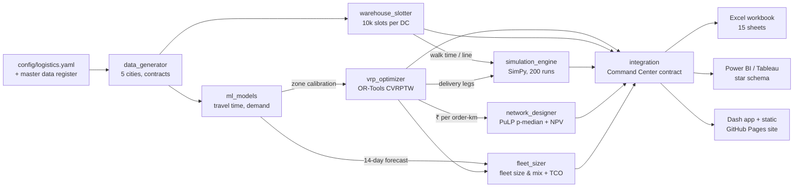

# Logistics and Network Design

### CVRPTW Routing · Fleet Size & Mix · Warehouse Slotting · SimPy DC Simulation · p-Median Network Design · ML Travel Time & Demand

[](https://github.com/kushagrakartikey-dev/logistics-and-network-design/actions/workflows/ci.yml)
[](https://github.com/kushagrakartikey-dev/logistics-and-network-design/actions/workflows/pages.yml)


**Project 6 of a supply chain analytics portfolio.** An end-to-end logistics system for a 3PL running **15 facilities and 125 vehicles across five metros — Mumbai, Delhi NCR, Bengaluru, Chennai and Kolkata, in seven states and union territories (about 1,160 orders a day, 2,206 at the Diwali peak)**. It runs five decisions in sequence: route the day's orders → size the fleet for growth → re-slot each warehouse → test DC rosters against a 2-hour promise over 200 simulated days → decide where micro-fulfilment centres pay back. Every result is published to a live-formula Excel workbook, Power BI and Tableau specifications, and an interactive dashboard.

▶ **[Open the live dashboard](https://kushagrakartikey-dev.github.io/logistics-and-network-design/)**: 18 charts, 7 tables, six views, 16 working controls, no install required.

The live page is a static control-tower app (`dashboard/static/`). Every view renders in the browser from one compact data payload (`dashboard/static/data/payload.json`, built by `src/logistics/reporting/payload.py`), so it never calls back to Python. GitHub Actions publishes it to GitHub Pages on every push. Everything works online: the city selector, the status rail, the click-to-select scorecard, the route-plan toggle and the NPV sliders that recalculate five-year value in the browser. A headless-browser test (`tests/smoke/test_static_dashboard.py`) drives the site before publishing and again against the deployed URL. The local Dash app (`dashboard/app.py`) reads the same payload with Python callbacks, for development.

| Cluster | States / UTs | Depots |
|---|---|---|
| Mumbai MMR | Maharashtra | Bhiwandi DC · Andheri MFC · Navi Mumbai Hub |
| Delhi NCR | Delhi, Haryana, Uttar Pradesh | Gurugram Bilaspur DC · Okhla MFC · Noida Hub |
| Bengaluru | Karnataka | Hoskote DC · Koramangala MFC · Peenya Hub |
| Chennai | Tamil Nadu | Sriperumbudur DC · Guindy MFC · Ambattur Hub |
| Kolkata | West Bengal | Dankuni DC · Salt Lake Sector V MFC · Howrah Hub |

## Results (measured, representative day 10 Sep 2025 unless stated)

| Question | Result | Target | Verdict |
|---|---|---|---|
| Last-mile routing cost | **−28.8%** total incl. outsourcing; **−29.8%** fleet cost; 79 vs 99 vehicles | 15–22% | Exceeds |
| Delivery windows | **98.4%** in-window (baseline 98.0%) | > 95% | Met |
| Fleet sizing | Today's volume needs 79–87 vehicles across the five cities, not 125 (two near-equal-cost solutions: 79 at ₹3.45 lakh/day, 98.4% on-time; 87 at ₹3.47 lakh/day, 98.9%); 126 at 1.5x, 170 at 2.0x, 277 at 3.0x | > 95% where feasible | Met at all national levels; one city-level infeasible (Mumbai MMR at 3x (94.5%)) |
| Picker travel | **−26.2%** (held-out picks; best-possible ceiling 27.0%) | −35% | Below — ceiling is the limit |
| Pick throughput | **+23.4%**; heavy-item violations 615 → 0 per DC | +25–30% | Below |
| DC 2-hour dispatch (P95, 200 runs) | Current rosters: 101–307 min; optimized: 88–106 min; Diwali at current roster: 351–543 min | ≤ 120 min | Met with optimized/peak rosters |
| MFC network (5-yr NPV, 12% WACC) | Negative in all cities at today's volume; **Delhi NCR first**, break-even ~551 parcels/day (2.8×) | Quantified | Quantified |
| ML | Travel-time MAE −24%; zone-demand MAE −25% vs baselines (last 21 days unseen) | Beat baseline | Met |

Where targets are missed the workbook says so and explains why (`Scenario Comparison` sheet). City detail, trade-offs (e.g. small on-time give-backs in Bengaluru, Chennai and Kolkata for 26–45% savings) and recommendations are in [`CASE_STUDY.md`](CASE_STUDY.md); methods in [`METHODOLOGY.md`](METHODOLOGY.md).

## Architecture



```
logistics-and-network-design/
├── config/logistics.yaml          all parameters + master data register
├── src/shared/                    config, logging, geo, I/O, validation, solvers, design tokens, Command Center contract
├── src/logistics/                 data_generator, ml_models, vrp_optimizer, fleet_sizer, warehouse_slotter,
│   │                              simulation_engine, network_designer, integration, common
│   └── reporting/                 excel_report, xl_helpers, bi_export, payload
├── dashboard/app.py               local Plotly Dash app (Python callbacks)
├── dashboard/static/              static GitHub Pages dashboard (HTML/JS, vendored plotly.js 2.35.2)
├── docs/bi/                       Power BI model + DAX, Tableau calculated fields + LODs
├── tests/                         pytest suite (unit, integration, reporting) + tests/smoke (Playwright)
├── .github/workflows/             ci.yml (3.11/3.12, lint, tests, pipeline) · pages.yml (build, deploy, smoke)
├── outputs/                       workbook, maps, tables, BI exports, Command Center contract
├── run_demo.py · CASE_STUDY.md · METHODOLOGY.md · LICENSE
```

## Run it

```bash
python -m venv .venv && source .venv/bin/activate
pip install -r requirements.txt
python run_demo.py --modules all --export-reports --open-dashboard   # ~30 min on one CPU core
python run_demo.py --modules all --fast --export-reports             # reduced budgets, ~8 min
python -m src.logistics.vrp_optimizer                                # any module on its own
pytest                                                               # unit/integration tests
python -m playwright install chromium && pytest -m smoke tests/smoke -o addopts=""   # browser smoke test
```

Static dashboard locally: `python -m http.server -d dashboard/static 8000` → <http://localhost:8000> (tabs are linkable: `#routes`, `#fleet`, `#warehouse`, `#simulation`, `#network`).

## Deliverables

| Deliverable | Where | Notes |
|---|---|---|
| Excel workbook | `outputs/logistics_and_network_design.xlsx` | 15 sheets, Executive Dashboard last; 37 native charts, KPI cards, heatmaps, data bars, colour scales, sparklines, 156 live formulas (zero errors on LibreOffice recalculation); live NPV model ties out to Python |
| Route & network maps | `outputs/logistics/maps/*.html` | Folium, one per city, optimized vs baseline layers |
| Power BI / Tableau | `outputs/logistics/bi/` + `docs/bi/` | 25 import-ready tables (8 dims, 17 facts), manifest, relationships, DAX, Tableau calcs/LODs. **No .pbix/.twb files** — author them in the desktop tools from these assets |
| Dash app | `dashboard/app.py` | Overview + five module tabs, Python callbacks, same payload as the static site |
| Static dashboard | `dashboard/static/` | Runs entirely in the browser; NPV recalculates client-side with WACC/growth sliders |
| Command Center contract | `outputs/command_center/logistics_contract.json` | Lane lead-time σ for Output 5, delivered cost for Output 4, workload, MFC ranking |

## Deployment notes and limitations

* **GitHub Pages** hosts the static build in `dashboard/static/`; the Pages workflow tests and publishes the committed build (about 3 minutes) rather than re-running the ~40-minute pipeline. After changing models or data, rebuild with `python run_demo.py --modules all --export-reports` and commit `dashboard/static/data/payload.json`. The Dash app needs a Python server (run it locally). Map tiles load from CARTO and need internet.
* **Tests:** 47 unit/integration tests and 9 headless-browser smoke tests (56 total) pass locally on Python 3.12; the CI and Pages badges above show the live status on GitHub.
* Road distances are estimates (straight-line × 1.35); traffic is banded by time of day; OR-Tools runs are time-limited, so KPIs can move by about a point between runs.
* **OR-Tools and `highspy` conflict when loaded in one process.** PuLP uses HiGHS when available, otherwise CP-SAT for the (all-integer) p-median. See `src/shared/solvers.py`.
* **Portfolio integration:** Outputs 1–5 were not present when this was built. `src/shared/` defines the conventions and Command Center contract for them; upstream-dependent figures (e.g. safety-stock impact) show "awaiting upstream" rather than estimates.

## License
MIT — see [LICENSE](LICENSE). Vendored plotly.js is MIT-licensed (`dashboard/static/vendor/PLOTLY_LICENSE.txt`).
